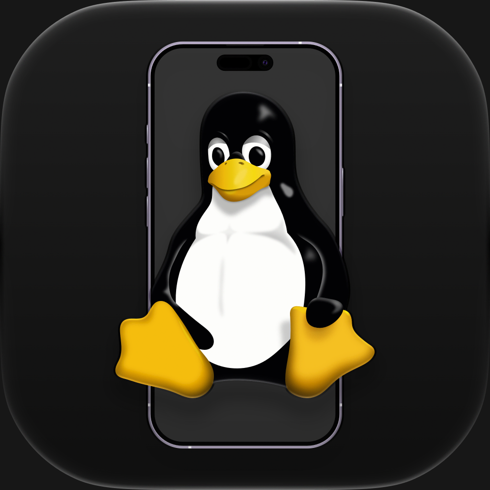

<div align="center">



# Linuxed

**A real Linux kernel, running natively inside an iPhone app.**

No jailbreak. No remote server. Just Linux, in your pocket.

[](https://github.com/Kelly-Inc/Linuxed/actions/workflows/linuxed-ipa.yml)
[](https://respring.lol/repo)
[](https://discord.gg/YOUR-INVITE)
[](LICENSES/README.md)

[Install](#install) · [Desktops](#desktops) · [Features](#features) · [How it works](#how-it-works) · [Community](#community)

</div>

---

## Install

Linuxed is distributed through its AltStore-compatible source. In AltStore, SideStore or LiveContainer, add:

```
https://respring.lol/repo
```

Then open **Linuxed**, tap **Add a guest**, and import or download a desktop image. Every image keeps your changes between launches; delete its `.changes` file in the Files app to start fresh.

## Desktops

| Image | What it is |
| --- | --- |
| **Debian XFCE** | A light, classic desktop with windows and a panel. |
| **Debian Phosh** | A touch-first phone interface with an on-screen keyboard. |
| **Debian Plasma Mobile** | KDE's phone shell. |
| **Debian ztMETRO** | The Windows Phone–style Metro shell from [ztOS](https://github.com/Zerone-Laboratories/ztOS). |

Every image logs in as `user` on host `linuxed`, with passwordless `sudo`, `apt`, and the phone's battery shown as a real power supply.

## Features

- **Real kernel** — mainline Linux 6.18 LTS, compiled to native arm64 and running inside the app.
- **GPU acceleration** — Vulkan 1.4 through [KosmicKrisp](https://docs.mesa3d.org/drivers/kosmickrisp.html), OpenGL 4.6 and GLES 3.2 through [Zink](https://docs.mesa3d.org/drivers/zink.html), all on Metal.
- **Hardware video** — H.264 and HEVC encode and decode through VideoToolbox.
- **Optional JIT** — launched with JIT enabled through [StikDebug](https://github.com/StikDebug/StikDebug), Linux programs run on a much faster JIT engine; otherwise the interpreter runs everything.
- **Your phone, inside Linux** — battery level and charging state, touchscreen, keyboard, microphone and sound.
- **Networking** — the full Linux network stack over your phone's Wi-Fi or mobile data, plus SSH over USB on port 2222.
- **Runs your code** — `arm64`, `arm32` and `x86_64` programs, Docker-style containers, namespaces and SELinux.

## How it works

The [User-mode Linux](https://en.wikipedia.org/wiki/User-mode_Linux) kernel is compiled to native arm64 and linked into an iOS runtime framework, so the kernel itself runs without emulation. Programs inside Linux run on an [iSH](https://github.com/ish-app/ish)-style threaded interpreter with SMP support, or on the JIT engine when iOS allows it. That puts Linuxed between a full system emulator like [UTM](https://github.com/utmapp/UTM) and a userspace emulator like iSH: a real kernel, with only userspace emulated.

## Building

The build system is CMake with the checked-in presets, plus an Xcode project for the app. Contributors and coding agents should start with [`AGENTS.md`](AGENTS.md) and [`docs/`](docs/README.md); CI builds the kernel, the desktop images and an unsigned `.ipa` on every push.

## Community

Questions, screenshots and bug reports are welcome on **[Discord](https://discord.gg/YOUR-INVITE)**.

## Credits

- **Skylo** ([@heyskylo](https://x.com/heyskylo)) — developer
- **[timi2506](https://github.com/timi2506)** — icon designer
- Linuxed grew out of the Kernarium project, and stands on [User-mode Linux](https://user-mode-linux.sourceforge.net/), [Mesa](https://mesa3d.org/), [libslirp](https://gitlab.freedesktop.org/slirp/libslirp) and [FEX](https://github.com/FEX-Emu/FEX).

## License

Linuxed is licensed under GPL-2.0-or-later, except where a file's SPDX header says otherwise; see [`LICENSES/`](LICENSES/README.md). Desktop images bundle their own distributions' licences, and the ztMETRO image includes ztOS under GPL-3.0.
